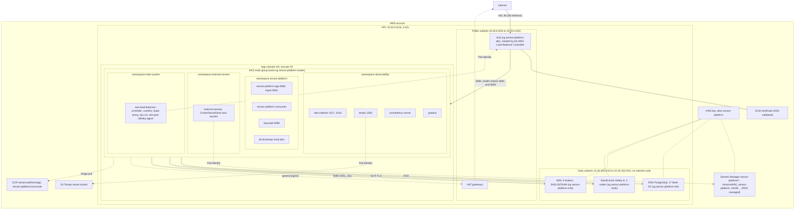
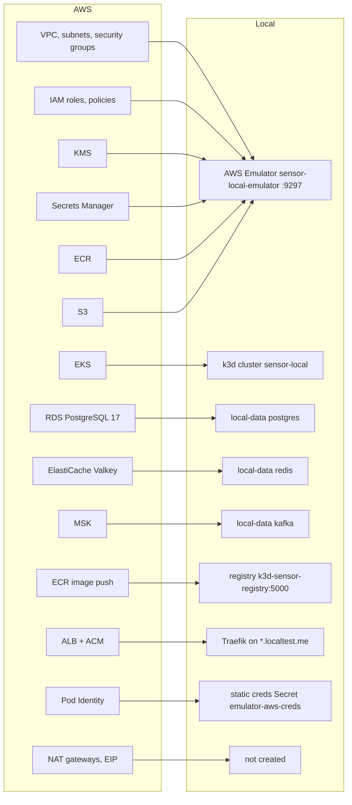
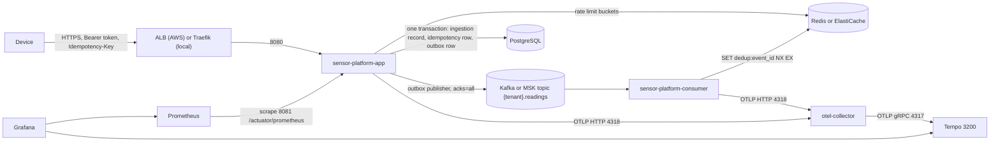
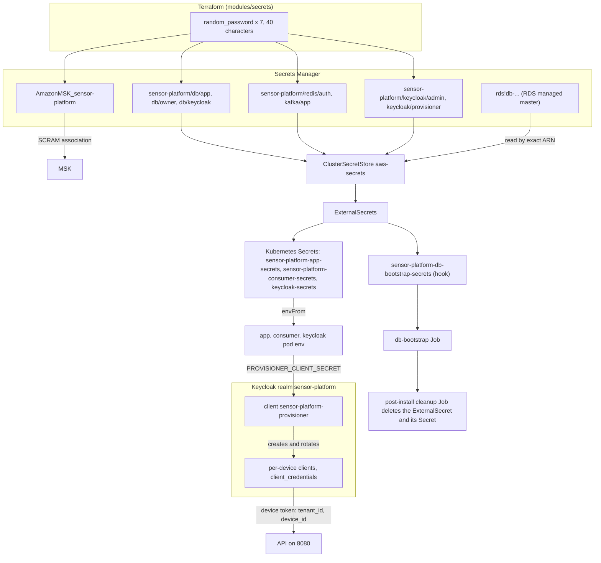

# Deployment

## Overview

The platform runs in two forms.

| Form | Where | Entry point |
|------|-------|-------------|
| Compose | One Docker host | `docker-compose.yml` (see README, Quick start) |
| Kubernetes | EKS on AWS, or k3d against the AWS Emulator | `deploy/` (Terraform, Helm charts, Helmfile) |

This document covers the Kubernetes form. Terraform in `deploy/terraform` builds the AWS resources, Helmfile in
`deploy/helmfile.yaml.gotmpl` installs the workloads. Both environments call the same modules and charts and differ in
provider settings, feature flags and values files.

| Environment | Terraform | Helmfile (`-e`) | Applied |
|-------------|-----------|-----------------|---------|
| `local` | `deploy/terraform/envs/local` against the AWS Emulator | `local` | Yes, by `scripts/aws-local.sh up` |
| `aws` | `deploy/terraform/envs/aws` | `aws` | No. Validated, linted and rendered only |

Detail lives next to the code: `deploy/terraform/README.md`, `deploy/helm/README.md`, `deploy/spike/README.md`.

## Topology on AWS

Names, ports and security groups below come from `deploy/terraform/modules/*` and `deploy/helm/sensor-platform/values-aws.yaml`.



Security group edges (`modules/network/main.tf`):

| From | To | Port |
|------|----|------|
| 0.0.0.0/0 | `sensor-platform-alb` | 443, 80 |
| `sensor-platform-alb` | `sensor-platform-nodes` | 8080 (`app_port` and `keycloak_port`, both 8080), plus the health check ports 8081 (app management) and 9000 (Keycloak management), variable `health_check_ports` |
| `sensor-platform-nodes` | `sensor-platform-rds` | 5432 |
| `sensor-platform-nodes` | `sensor-platform-redis` | 6379 |
| `sensor-platform-nodes` | `sensor-platform-msk` | 9096 |

The data tiers accept nothing else. Node egress to ECR, STS, DNS and S3 comes from the EKS module's own node security
group and goes through the NAT gateways (one per AZ unless `single_nat_gateway`).

Sizing defaults (module variables): EKS 1.34, `m7i.large` nodes, min 3, desired 3, max 6; RDS `db.m7g.large`, 100 GiB
growing to 500 GiB, 14 days of backups; ElastiCache `cache.t4g.medium` x 3; MSK `kafka.m7g.large` x 3 with 100 GiB each.

## Local vs AWS mapping

| AWS | Local stand-in | Notes |
|-----|----------------|-------|
| VPC, subnets, security groups | AWS Emulator, container `sensor-local-emulator` | Created by `envs/local`; no traffic flows through them |
| IAM roles and policies | AWS Emulator | Created, not enforced |
| KMS key | AWS Emulator | |
| Secrets Manager `sensor-platform/*` | AWS Emulator | Read by External Secrets |
| ECR repositories | AWS Emulator creates the repositories | Images are pushed to the k3d registry instead |
| S3 Tempo bucket | AWS Emulator creates it | Tempo writes to a local volume (`values/tempo-local.yaml`) |
| EKS | k3d cluster `sensor-local`, one server, no agent | k3s v1.33.5 |
| RDS PostgreSQL 17 | `local-data` chart, `postgres:17-alpine` | No TLS, no backups, no HA |
| ElastiCache Valkey | `local-data` chart, `redis:7.4.12-alpine`, AUTH, no TLS | `REDIS_SSL=false` |
| MSK | `local-data` chart, `apache/kafka:3.9.0`, KRaft, one broker | `SASL_PLAINTEXT` + SCRAM-SHA-512 on 9092, replication factor 1 |
| ECR image push | k3d registry `k3d-sensor-registry:5000` (host port 5001) | |
| ALB + ACM | Traefik (k3s default) on `127.0.0.1:80`, hosts `*.localtest.me` | HTTP only |
| Pod Identity | Static dummy credentials in Secret `emulator-aws-creds` | Used by the ClusterSecretStore |
| NAT gateways | Not created | `create_nat = false` |



## Prerequisites

- Docker Desktop with about 5 GB of free memory for the local run. Peak use is about 4.4 GiB (k3s server about
  3.9 GiB, emulator about 210 MiB); the Docker limit on the measured host was 7.57 GiB.
- Git Bash on Windows. Python on the host only for `demo`.
- Every other tool runs in a pinned container: `hashicorp/terraform:1.17.2`, `ghcr.io/k3d-io/k3d:5.9.0`,
  `rancher/k3s:v1.33.5-k3s1`, `ghcr.io/helmfile/helmfile:v1.1.9`, `bitnamilegacy/kubectl:1.33.4`.
- For AWS: an AWS account and credentials (see the warning below).

## Local run

```bash
docker compose -p sensor-platform stop     # the script refuses to run while compose containers run
bash scripts/aws-local.sh up
bash scripts/aws-local.sh status
bash scripts/aws-local.sh demo
bash scripts/aws-local.sh deploy           # after code changes
bash scripts/aws-local.sh down
docker compose -p sensor-platform start
```

| Command | Does |
|---------|------|
| `up` | Checks that no compose container of project `sensor-platform` runs, builds the emulator image `sensor-spike/aws-emulator:1.0.556` if missing and starts it, runs `terraform apply` in `envs/local` and a second plan that must show no drift, creates the k3d cluster, builds and pushes both images tagged `local-<timestamp>`, runs `helmfile -e local apply`, then waits until every pod is Ready (600 s limit) |
| `deploy` | Rebuilds and pushes the images with a new tag, runs `helmfile -e local apply`, waits for Ready. Needs a cluster from `up` |
| `status` | `kubectl get pods -A`, ingresses, ExternalSecrets, Terraform outputs |
| `demo` | `python scripts/demo.py all --target k8s` |
| `down` | Removes what `up` created (below) |

`up` takes about 11 to 12 minutes. The demo run recorded for this setup passed 127 checks.

Endpoints after `up`: `http://sensor.localtest.me`, `http://keycloak.localtest.me`, `http://grafana.localtest.me`
(public DNS resolves `*.localtest.me` to 127.0.0.1). The Kubernetes API is on `127.0.0.1:6550`. If host port 80 is taken,
the Keycloak issuer in `values-local.yaml` and `keycloak/values-local.yaml` must change with it.

`down` deletes: cluster `sensor-local`, containers `k3d-sensor-registry`, `sensor-local-kubectl`,
`sensor-local-emulator`, `sensor-local-tf`, `sensor-local-k3d`, `sensor-local-helmfile`, network `sensor-local-net`,
the Terraform state in `.scratch/tf/local`, and under `.scratch/aws-local/` the emulator home, `tf-data`, kubeconfigs,
`k3d.yaml` and `tf-outputs.json`. It keeps logs and tool caches in `.scratch/aws-local/` and does not remove Docker images
(emulator, app, consumer). It takes about 6 s.

## AWS deployment steps

> **Warning.** These steps create billable resources (EKS, NAT gateways, Multi-AZ RDS, MSK, ElastiCache, an ALB) in
> the account whose credentials you use. Nothing in this repository has been planned or applied against a real AWS
> account. `envs/aws` has only been checked with `terraform init -backend=false`, `validate`, `fmt` and the linters.
> Read the plan before applying.

1. **Inputs.** In `deploy/terraform/envs/aws` set the variables below, for example in an untracked `terraform.tfvars`.

   | Variable | Default | Meaning |
   |----------|---------|---------|
   | `domain_name` | none | Subject of the ACM certificate. The certificate also carries the subject alternative name `*.<domain>`, which covers `sensor.<domain>` and `keycloak.<domain>` |
   | `tempo_bucket_name` | none | Globally unique bucket name |
   | `region` | `us-east-1` | Must match `region` in `deploy/environments/aws.yaml` |
   | `eks_endpoint_public_access_cidrs` | `[]` | Empty keeps the EKS API private to the VPC; helmfile must then run from inside the VPC |

2. **State backend.** The S3 backend block in `envs/aws/versions.tf` is commented out. Create an encrypted, versioned
   bucket limited to the platform owners, fill in `bucket`, `key`, `region`, `kms_key_id`, uncomment the block, then run
   `terraform init`. Without it the state, which holds the generated passwords in clear text, stays on the local disk.
3. **Apply.** Terraform is pinned to exactly 1.17.2 with provider `hashicorp/aws` 6.73.0.

   ```bash
   cd deploy/terraform/envs/aws
   terraform init
   terraform plan -out tfplan
   terraform apply tfplan
   terraform output
   ```

4. **DNS.** Create the validation records from output `acm_validation_records` and wait until the certificate is issued.
   After step 7 creates the ALBs, point `sensor.<domain>` and `keycloak.<domain>` at them. Terraform does neither.
   No ingress group annotation is set, so the controller creates one ALB per Ingress (app and Keycloak).
5. **Images.** Nothing in the repository pushes images to ECR on AWS. Build `sensor-platform/app` (repository root) and
   `sensor-platform/consumer` (`consumer/`) and push them to the URLs in output `ecr_repository_urls`. The ECR repositories
   are tag-immutable. `image.app.tag` and `image.consumer.tag` are empty in `values-aws.yaml`, so the tag defaults to the
   chart `appVersion` (`0.1.0`).
6. **Fill the `REPLACE_*` values** from the Terraform outputs.

   | File | Key or placeholder | Source |
   |------|--------------------|--------|
   | `deploy/environments/aws.yaml` | `vpcId` | `vpc_id` |
   | | `registry` | `ecr_repository_urls`, host part |
   | | `tempoBucket` | `tempo_bucket_name` |
   | `deploy/helm/sensor-platform/values-aws.yaml` | `image.registry` | `ecr_repository_urls`, host part |
   | | `config.db.host` | `rds_address` |
   | | `config.redis.host` | `redis_primary_endpoint` |
   | | `config.kafka.bootstrapServers` | `msk_bootstrap_brokers_sasl_scram` |
   | | `dbBootstrap.master.secretId` | `rds_master_secret_arn` |
   | | `alb.ingress.kubernetes.io/certificate-arn` | `acm_certificate_arn` |
   | | `alb.ingress.kubernetes.io/security-groups` | `security_group_ids`, key `alb` |
   | | `REPLACE_DOMAIN` (ingress host, Keycloak issuer URI) | your domain |
   | `deploy/helm/keycloak/values-aws.yaml` | `hostname`, `ingress.hosts`, `REPLACE_DOMAIN` | your domain |
   | | `db.host` | `rds_address` |
   | | certificate ARN, ALB security group | as above |

   The network policy CIDRs in `values-aws.yaml` are the Terraform defaults for `10.20.0.0/16`; change them with the VPC.

7. **Install.**

   ```bash
   aws eks update-kubeconfig --name sensor-platform --region us-east-1
   cd deploy
   helmfile -e aws template    # render first
   helmfile -e aws apply
   ```

   Release order (`needs`): `external-secrets`, `eso-config`, `aws-load-balancer-controller`, `sensor-platform`
   (db-bootstrap hooks), `keycloak`. `tempo`, `otel-collector`, `prometheus` and `grafana` are independent.
   `helmDefaults` set `wait: true`, `timeout: 600`.

## Request, trace and data flow



Notes:

- The app answers `202` after the database commit. Kafka is called outside the transaction by the outbox publisher.
- The consumer subscribes with the regex `^.*\.readings$` in one group (`sensor-readings-consumer`).
- Prometheus scrapes `sensor-platform-app.sensor-platform:8081` every 15 s (`values/prometheus.yaml.gotmpl`).
- Tracing sampling is `1.0` locally and `0.1` on AWS (`values-aws.yaml`).

## Identity and secrets



- The `aws-secrets` store authenticates with Pod Identity (service account `external-secrets/external-secrets`) on AWS and
  with the static credentials Secret `emulator-aws-creds` locally.
- The app and consumer service accounts have no AWS role. They never call AWS.
- On AWS the app validates tokens against the in-cluster JWK set `http://keycloak:8080/realms/sensor-platform/...`; the
  issuer is the public `https://keycloak.<domain>/realms/sensor-platform`.
- Locally the db-bootstrap master login is the `postgres-superuser` Secret of `local-data`.

## Secrets and rotation

ExternalSecrets read `sensor-platform/<key>` and write Kubernetes Secrets that pods load with `envFrom`.

| Environment variable | Secrets Manager name | JSON key | Kubernetes Secret | Used by |
|---|---|---|---|---|
| `DB_USER` / `DB_PASSWORD` | `sensor-platform/db/app` | `username` / `password` | `sensor-platform-app-secrets` | app |
| `DB_MIGRATION_USER` / `DB_MIGRATION_PASSWORD` | `sensor-platform/db/owner` | `username` / `password` | `sensor-platform-app-secrets` | app (Flyway) |
| `REDIS_PASSWORD` | `sensor-platform/redis/auth` | `auth_token` | `sensor-platform-app-secrets`, `-consumer-secrets`, `redis-auth` (local-data) | app, consumer, Redis |
| `KAFKA_SASL_USERNAME` / `KAFKA_SASL_PASSWORD` | `sensor-platform/kafka/app` | `username` / `password` | `sensor-platform-app-secrets`, `-consumer-secrets`, `kafka-scram` (local-data) | app, consumer, local Kafka |
| `PROVISIONER_CLIENT_SECRET` | `sensor-platform/keycloak/provisioner` | `client_secret` | `sensor-platform-app-secrets`, `keycloak-secrets` | app, Keycloak realm import |
| `KC_BOOTSTRAP_ADMIN_USERNAME` / `_PASSWORD` | `sensor-platform/keycloak/admin` | `username` / `password` | `keycloak-secrets` | Keycloak |
| `KC_DB_USERNAME` / `KC_DB_PASSWORD` | `sensor-platform/db/keycloak` | `username` / `password` | `keycloak-secrets` | Keycloak |
| `OWNER_*`, `APP_*`, `KEYCLOAK_DB_*` | `db/owner`, `db/app`, `db/keycloak` | as above | `sensor-platform-db-bootstrap-secrets` (hook, removed after) | db-bootstrap |
| `PGUSER` / `PGPASSWORD` | the RDS managed master secret (ARN from values) | `username` / `password` | same hook Secret | db-bootstrap (AWS) |

Rotation behavior:

- Refresh intervals are `1h` on AWS and `1m` locally (`externalSecrets.refreshInterval`). A changed Secrets Manager value
  reaches the Kubernetes Secret in place.
- Pods are not restarted when a Secret changes. Only ConfigMap changes roll pods (checksum annotation). After a
  refresh, restart the workloads that use the secret:
  `kubectl -n sensor-platform rollout restart deploy/sensor-platform-app deploy/sensor-platform-consumer`.
- A changed database password reaches the database only when db-bootstrap runs again, which sets the role passwords on
  every run: `helm upgrade` the `sensor-platform` release (see docs/OPERATIONS.md).
- Terraform owns the values (`random_password`). They are stored in Terraform state in clear text, so the state backend
  must be encrypted.
- The Kafka SCRAM user is written when the local broker's volume is first formatted. Changing `sensor-platform/kafka/app`
  locally needs a fresh volume: `kubectl -n sensor-platform delete pvc data-kafka-0`, then let the broker pod restart.
  On AWS, MSK reads the same credentials from `AmazonMSK_sensor-platform`, which Terraform writes from the same password.
- Keycloak realm secrets `DEMO_USER_PASSWORD`, `ALPHA_INGEST_CLIENT_SECRET`, `BETA_INGEST_CLIENT_SECRET` are not in
  Secrets Manager (see Security notes).

## Database roles

The `db-bootstrap` Helm hook (`deploy/helm/sensor-platform/files/db-bootstrap.sql`, image `postgres:17-alpine`) runs
before every install and upgrade of `sensor-platform`, as the master login. It is idempotent: roles and databases are
created only when missing, attributes and passwords are asserted on every run.

| Role | Attributes | Purpose |
|------|------------|---------|
| `sensor_owner` | LOGIN NOSUPERUSER NOCREATEDB NOCREATEROLE NOREPLICATION NOBYPASSRLS | Owns database `sensor_platform`; the Flyway user (`DB_MIGRATION_USER`) |
| `sensor_app` | same attributes | Runtime role (`DB_USER`); owns nothing; table grants come from Flyway V3; subject to row-level security |
| `keycloak` | same attributes | Owns database `keycloak` |

`CONNECT` is revoked from PUBLIC on both databases. The master login is the RDS managed secret on AWS and the
`local-data` superuser locally. After the Job succeeds, a post-install Job deletes the `db-bootstrap` ExternalSecret
and the Secret it owns, so the master credentials do not stay in the cluster.

Migrations therefore no longer run as a superuser on AWS or in k3d. Compose still uses its own init script
(`infra/postgres/init/10-app-role.sh`).

## Scaling and sizing

| Component | AWS values | Local values |
|-----------|-----------|--------------|
| App replicas | HPA `minReplicas` 3, `maxReplicas` 9, target CPU 70%, request 500m | 1, no HPA |
| App PodDisruptionBudget | `minAvailable: 2` | disabled |
| App spread | zone `topologySpreadConstraints`, `ScheduleAnyway`; rolling update `maxUnavailable: 0`, `maxSurge: 1` | rolling update only |
| Consumer replicas | 3, fixed, no HPA, no PDB | 2 |
| Keycloak | 2 replicas, JGroups DNS discovery, zone anti-affinity (preferred) | 1 |

- Each app replica opens up to 10 database connections (`spring.datasource.hikari.maximum-pool-size`), so 9 replicas
  can hold 90. Check this against the RDS connection limit before raising `maxReplicas`.
- Consumers: every tenant topic has 3 partitions (`platform.kafka.topic-partitions`) and all consumers share one
  group. Replicas beyond the total number of partitions of the subscribed topics (3 per tenant) stay idle. Scale with
  `kubectl -n sensor-platform scale deploy/sensor-platform-consumer --replicas=N`; a later `helm upgrade` resets it to
  `consumer.replicas`.
- MSK: 3 brokers, `default.replication.factor=3`, `min.insync.replicas=2`; the app creates topics with replication factor 3
  (`config.kafka.topicReplicationFactor`). With producer `acks=all`, one broker can be down; with two down, publishing
  fails and outbox rows stay `PENDING` until the brokers return. Local Kafka uses replication factor 1.
- Redis memory: one dedup key costs about 150 B (measured 153 in docs/OPERATIONS.md) and lives
  `DEDUP_TTL_SECONDS` (`config.consumer.dedupTtlSeconds`, 604800 s). Rule:

  ```
  dedup memory = sustained events per second x 604800 x 150 B   (about 90 MB per event/s)
  ```

  Add rate limit keys (small, they expire when idle). Compare the result with the node memory of `node_type`
  (default `cache.t4g.medium`). ElastiCache uses `maxmemory-policy volatile-ttl`, as compose does (parameter group `sensor-platform-redis-valkey8`);
  compose and `local-data` size Redis at `maxmemory 96mb`. Under pressure, evicted dedup keys mean redelivered events are
  processed again.

## Security notes and known gaps

- **DB TLS.** AWS uses `sslmode=require` (JDBC `DB_URL`, db-bootstrap `PGSSLMODE`). The connection is encrypted and
  the server certificate is not verified. Production should use `verify-full` with the RDS CA bundle. The parameter group
  sets `rds.force_ssl=1`.
- **Keycloak realm secrets.** The demo user and the alpha and beta ingest client secrets are generated in the cluster by
  the `keycloak` chart (Secret `keycloak-realm-secrets`, kept across upgrades) and are not stored in Secrets Manager.
- **First-install ordering.** The db-bootstrap hooks run before the NetworkPolicies of the same release exist on the first
  install. On upgrades the policy for `db-bootstrap` (DNS and PostgreSQL only) applies.
- **Logging.** No VPC flow logs. The MSK and EKS CloudWatch log groups are not KMS-encrypted. No S3 gateway endpoint.
- **IAM.** The emulator does not enforce IAM, so least privilege is reviewed and linted (tflint, trivy), not tested.
- **Alerting.** Prometheus runs without Alertmanager (`alertmanager.enabled: false`); rules are evaluated and nothing is delivered.
- **State.** Terraform state holds all generated passwords in clear text.
- **Open gaps.** (1) Nothing in the repository pushes images to ECR on AWS (step 5 above). (2) The EKS API endpoint is
  private by default (`eks_endpoint_public_access_cidrs` empty), so Helmfile must run from inside the VPC unless CIDRs are set.
- **Health checks.** The ALB probes the app on 8081 and Keycloak on 9000 (`values-aws.yaml`, `keycloak/values-aws.yaml`).
  The SG rules open those ports (`health_check_ports`) and the app NetworkPolicy opens 8081 from the ALB subnets
  (`ingressHealthCheckPort`). Keycloak has no NetworkPolicy. Not applied on a real account.
- **Local data tier.** `local-data` has no TLS (Kafka `SASL_PLAINTEXT`, Redis AUTH without TLS), no backups and no HA.
  Local DB `sslmode` is empty.

## Known emulator gaps

AWS Emulator 1.0.556 (`deploy/spike/README.md`, `deploy/terraform/README.md`).

- No published image. `deploy/spike/emulator/Dockerfile` builds it from the vendor RPM pinned by sha256 on
  `amazonlinux:2023-minimal`. The vendor URL only serves `latest`, so the build breaks when the RPM is republished and
  the pin must be updated on purpose.
- The TLS certificate names only `localhost`, `127.0.0.1` and `::1`. Terraform therefore runs in the emulator's network
  namespace (`--network container:sensor-local-emulator`) with `AWS_CA_BUNDLE`, and External Secrets reaches the
  emulator through a socat sidecar (`emulator-tunnel`) listening on `127.0.0.1:9297` in the pod.
- Authentication is off (`--auth off`): any credentials are accepted. Publish the port on `127.0.0.1` only.
- EKS, RDS, ElastiCache and MSK are faked in the emulator and are not used (`create_eks`, `create_data_services` false).
- NAT gateway and EIP support is broken; `create_nat = false`.
- ECR push is not used; images go to the k3d registry.
- The network module uses the legacy `aws_security_group_rule` and not `aws_vpc_security_group_*_rule`: with
  `skip_requesting_account_id = true` the emulator returns the referenced group as `<account>/sg-...`, so the newer
  resources show a change on every plan. Do not turn account id lookup on; it makes the provider call
  `<account>.s3-control...`, which hangs or fails.
- The S3 lifecycle call takes about 58 s.
- `terraform init` of `envs/local` still downloads the EKS registry module although `create_eks = false`.

## Troubleshooting

| Symptom | Cause and fix |
|---------|---------------|
| Grafana pod `OOMKilled` (exit 137 about 2 s after start, then CrashLoop) | A 256Mi limit is too low. `values/grafana.yaml.gotmpl` sets request 192Mi and limit 512Mi |
| Pod event `lookup k3d-sensor-registry: no such host` | k3d 5.9.0 uses `registries.create.name` as is, with no `k3d-` prefix. The script names the registry `k3d-sensor-registry`, the value the charts expect. A cluster created with another name needs `down` and `up` |
| `terraform` appears to hang for minutes | TLS name mismatch: the client dialled the emulator by container name, not `127.0.0.1`. Terraform does not report the error and retries. Run it in the emulator's network namespace as `scripts/aws-local.sh` does, and wrap every call in `timeout` |
| `Error acquiring the state lock` after a timeout | `timeout` stops the docker client, not the Terraform container, which keeps the lock. `docker rm -f sensor-local-tf` (the script does this after each call; for manual runs remove the container you named). `force-unlock` was not needed |
| Pod in `CreateContainerConfigError`, for example the `db-bootstrap` Job pod | The Secret does not exist yet because the ExternalSecret has not synced. Helm does not wait for ExternalSecrets. Check `kubectl get externalsecret -A` and `kubectl describe externalsecret <name>`. The pod starts by itself once the Secret exists; the Job gives up after `activeDeadlineSeconds` 900 |
| `kubectl wait --for=condition=Ready pod --all` never ends | Completed Job pods are `Succeeded`, never Ready. The script adds `--field-selector=status.phase!=Succeeded` |
| `helmfile apply` fails in a later layer | One failing release blocks everything that `needs` it. Read `kubectl get pods -A` first, then the failing release |
| `up` stops with `compose project 'sensor-platform' has running containers` | `docker compose -p sensor-platform stop` |
| Kafka client auth fails locally after changing `kafka/app` | The SCRAM user was written at the first format of the volume. Delete PVC `data-kafka-0` |
